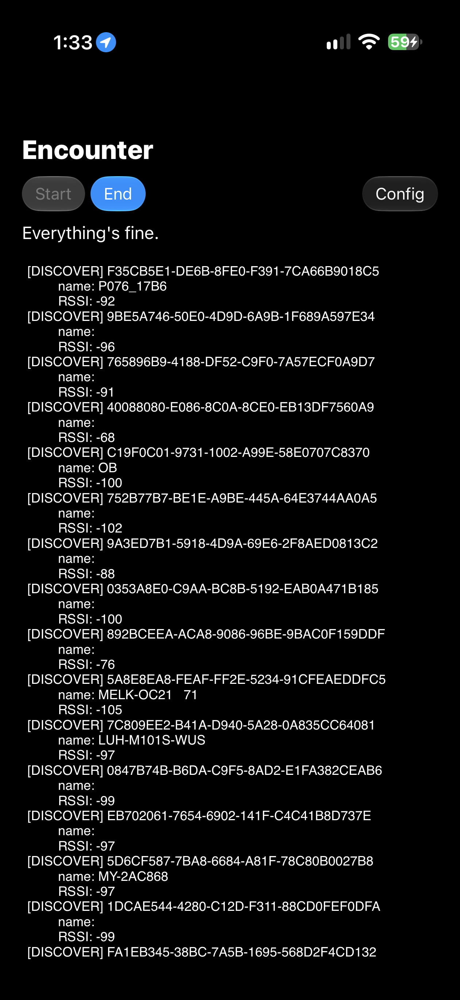

# Encounters Scanner

A little Bluetooth scanner app that continuously scans for nearby Bluetooth devices and tags them with the phone's GPS coordinates and the current time. Outputs data into a CSV that can be imported to a computer via sync for further processing.

